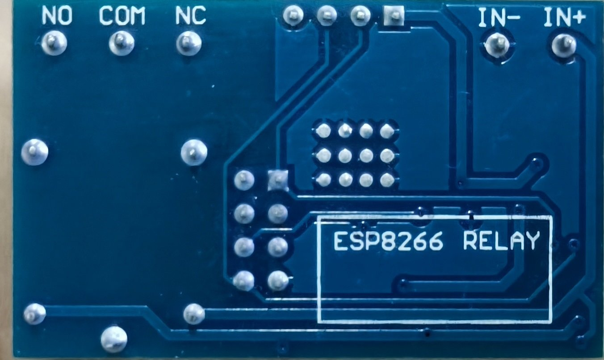
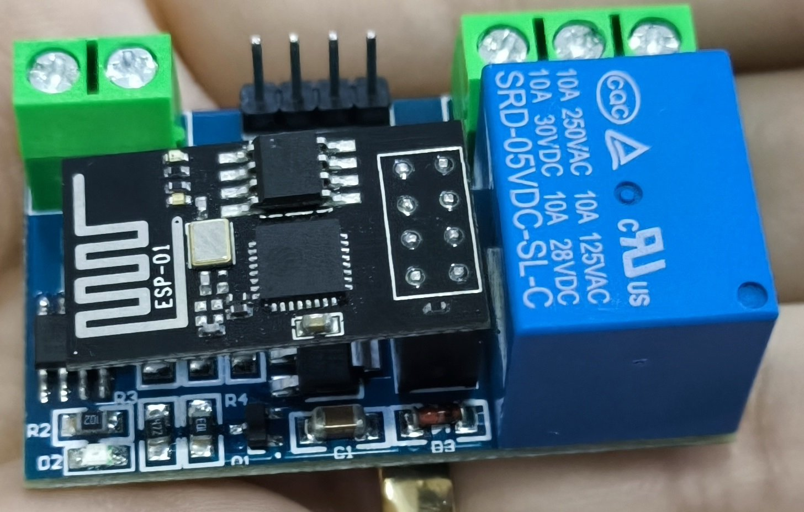
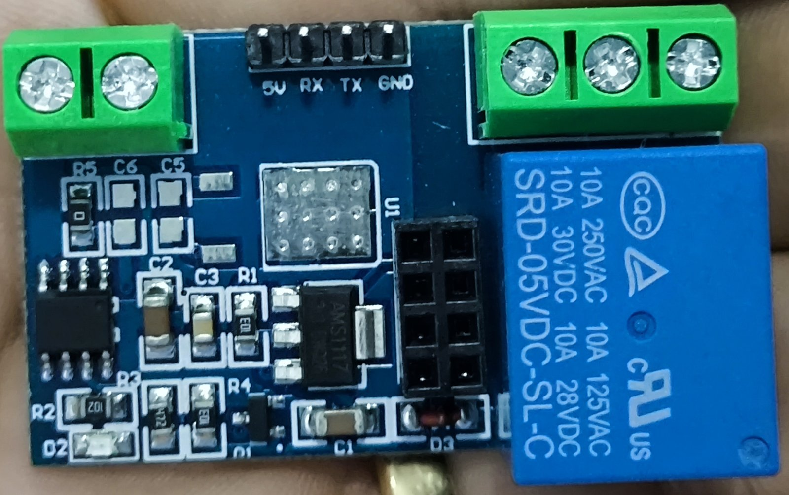
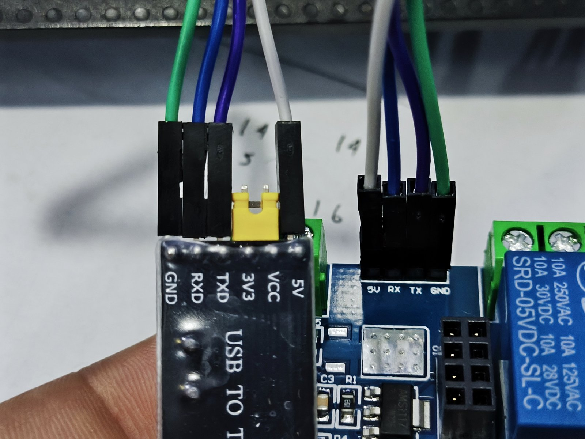
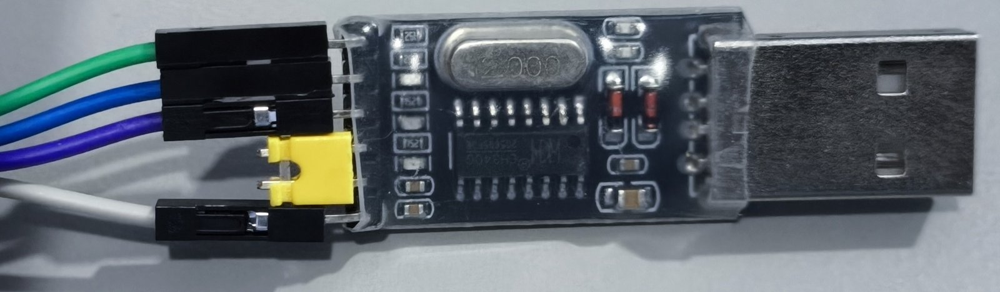
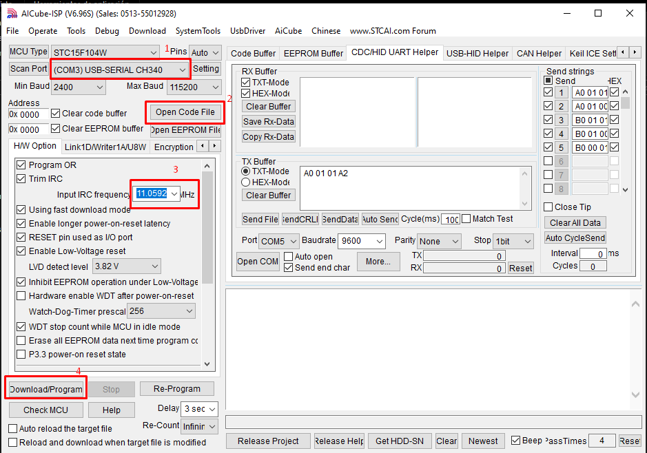
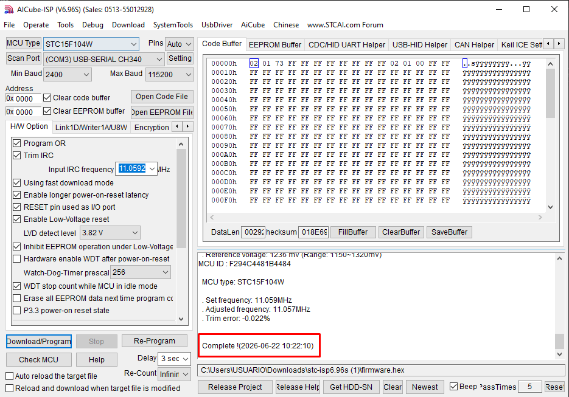
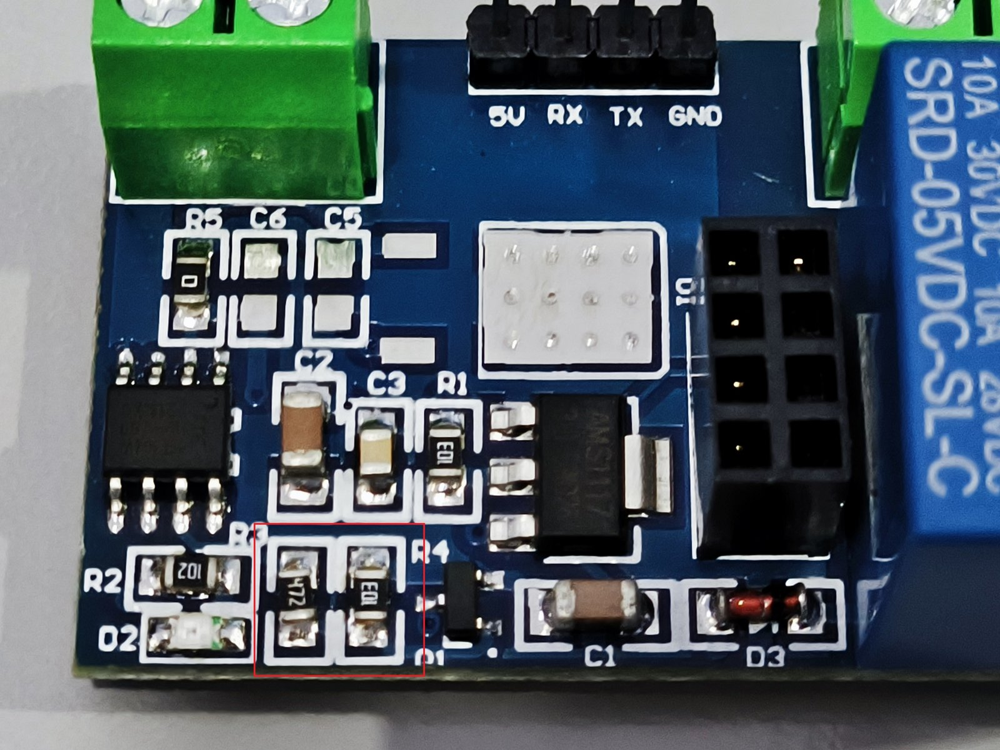

# Programming the ESP-01 + 1CH 5V Relay Module with STC15F104W

🌐 **English** | [Español](README.md)

A complete guide to understanding and getting the relay module based on the following to work properly:

* ESP-01 / ESP-01S
* 1CH 5V relay
* STC15F104W microcontroller

## Contents

1. [Introduction](#introduction)
2. [Repository structure](#repository-structure)
3. [How to tell if your module uses an STC15F104W](#how-to-tell-if-your-module-uses-an-stc15f104w)
4. [Serial communication (TX → TX)](#serial-communication)
5. [Programming the STC15F104W](#programming-the-stc15f104w)
6. [Programming procedure](#programming-procedure)
7. [Hardware modification (R3 / R4)](#hardware-modification-r3--r4)
8. [Relay control commands](#relay-control-commands)
9. [Wiring](#wiring)
10. [Common problems](#common-problems)
11. [Credits and references](#credits-and-references)

---

# Introduction

I bought an **ESP-01 + 1CH 5V Relay** module, expecting to control the relay directly from the ESP8266 GPIO pins.

However, after many tests, the relay did not respond correctly.

Digging deeper, I found that many of these modules include an additional microcontroller called the **STC15F104W**. This chip is what actually controls the relay.

The ESP-01 does not drive the relay directly; instead, it sends serial (UART) commands to the STC15F104W, which then switches the relay on or off.

This detail is rarely documented clearly, which is why I wrote this guide.

---

# Repository structure

```txt
.
├── README.md                     # Spanish guide
├── README.en.md                  # English guide
├── firmware/
│   └── firmware.hex              # Firmware for the STC15F104W
├── examples/
│   └── relay_toggle/
│       └── relay_toggle.ino      # ESP-01 example (Arduino IDE)
└── images/
    ├── hardware/                 # Photos of the module, chip, R3/R4 and UART wiring
    └── programacion/             # USB-TTL adapter and STC-ISP screenshots
```

---

# How to tell if your module uses an STC15F104W

Inspect the board.

If you find an 8-pin chip marked `STC15F104W`, your module most likely works via serial communication.

<p>
  
  
  
</p>

Internal architecture:

```txt
ESP-01 ---> UART ---> STC15F104W ---> Relay
```

Flow:

1. The ESP receives commands over WiFi
2. The ESP sends data over UART
3. The STC interprets that data
4. The STC switches the relay on/off

---

# Serial communication

## Important: non-standard UART wiring

An important detail of this module is that the serial connection **does not follow the usual UART convention**.

Normally, when two devices talk over UART, the pins are crossed:

```txt
ESP-01 TX → STC RX
ESP-01 RX → STC TX
```

## This module works differently

On this specific module, communication works with a straight-through connection:

```txt
ESP-01 TX → STC TX
ESP-01 RX → STC RX
```

## Why?

This is due to the module's internal PCB design and signal routing.

The traces are already laid out so that the correct connection is straight, not crossed.

So if you wire it using the standard UART convention, you will most likely find that:

* Programming fails
* There is no serial communication
* The relay does not respond

## Recommendation

Do not assume this module uses the traditional UART scheme.

Before diagnosing firmware or hardware problems, make sure the serial connections are made like this (`TX → TX`, `RX → RX`):



This was one of the most important details in getting the module to work.

The communication speed is **9600 baud**.

---

# Programming the STC15F104W

To program the **STC15F104W** microcontroller, I used STC's official software.

## Required software

Download the program from the official website:

* https://www.stcmicro.com/rjxz.html

I used version **STC-ISP 6.96S**.

## Required firmware

Download [`firmware/firmware.hex`](firmware/firmware.hex) from this repository.

This file contains the firmware the **STC15F104W** needs to control the relay correctly.

## Required hardware

To program the STC you need a **USB to TTL** adapter.

This is the one I used:



Common examples:

* CH340 USB-TTL
* FTDI USB-TTL
* CP2102 USB-TTL

## Connecting the USB-TTL to the STC

```txt
USB-TTL TX  → STC TX
USB-TTL RX  → STC RX
USB-TTL GND → GND
USB-TTL 5V  → VCC
```

> [!WARNING]
> Unlike a traditional UART connection, on this module the wiring is `TX → TX` and `RX → RX`. **Do not cross TX/RX.**

## STC-ISP software settings

Open **STC-ISP** and configure:



### 1. Select the COM port

Choose the COM port of your USB-TTL adapter (for example `COM3`, `COM4`, `COM5`).

### 2. Load the firmware

Load the file `firmware/firmware.hex`.

### 3. Check the IRC frequency

Make sure the detected IRC frequency is correct for the STC.

This setting is important for programming to succeed.

---

# Programming procedure

The STC15F104W enters programming mode when it is powered up.

For this reason, the order in which you connect things is very important.

### Step 1

Connect the **TX**, **RX** and **GND** wires from the USB-TTL to the STC, but **do NOT connect the 5V wire yet**.

### Step 2

Open **STC-ISP** and configure:

* COM port
* IRC frequency
* HEX firmware

### Step 3

Click **`Download/Program`**.

The program will wait for the microcontroller.

### Step 4

Now connect the **5V** wire.

As soon as the STC receives power, it enters bootloader mode and the software starts loading the firmware automatically.

### Step 5

Wait for programming to finish.

If everything goes well, the software will show a success message:



---

# Hardware modification (R3 / R4)

On some modules, reprogramming the **STC15F104W** may not be enough to get the relay to switch.

In my case, an additional PCB modification was needed: **swapping resistors R3 and R4**.

* The resistor in **R3** moves to **R4**
* The resistor in **R4** moves to **R3**



*Note: in this picture the resistors have already been swapped.*

## Before modifying the PCB

I recommend testing the module **without changing the resistors** first:

1. Reprogram the **STC15F104W**
2. Test whether the relay switches

If the relay switches correctly, **you don't need to modify R3 and R4**. Only make this change if the relay doesn't switch.

## Why is it needed?

Resistors **R3** and **R4** form a voltage divider that sets the signal reaching the transistor that drives the relay.

```txt
STC15F104W → voltage divider (R3/R4) → transistor → relay
```

With the original configuration on some modules, the divider produces a signal too weak to bias the transistor properly.

As a result:

* The transistor doesn't fully turn on
* The relay coil doesn't get enough current
* The relay doesn't switch

In other words, even if the STC is sending the signal correctly, the relay never gets energized.

## Solution

Swapping the positions of **R3** and **R4** changes the divider ratio and produces a signal strong enough to turn the transistor on properly.

After making this change, the relay started working normally.

## Symptoms of this problem

If your module shows any of these symptoms, you probably need this modification:

* The STC seems to work correctly
* Programming was successful
* The relay never "clicks"
* The LED may turn on, but the relay doesn't switch

## My experience

In my case, the complete fix required two steps:

* ✅ Reprogram the **STC15F104W**
* ✅ Swap **R3** and **R4**

Only after doing both did the module work correctly.

## Warning

> [!CAUTION]
> This modification requires experience working with SMD components. Be careful to avoid damaging the PCB.

Recommended tools:

* Fine-tip soldering iron
* Flux
* Precision tweezers
* Hot-air station (optional)

---

# Relay control commands

The ESP-01 sends the commands over UART at **9600 baud**:

```cpp
Serial.begin(9600);
```

| Action    | Hex command   |
|-----------|---------------|
| Relay ON  | `A0 01 01 A2` |
| Relay OFF | `A0 01 00 A1` |

## Relay ON

```cpp
byte relayOn[] = {0xA0, 0x01, 0x01, 0xA2};
Serial.write(relayOn, sizeof(relayOn));
```

## Relay OFF

```cpp
byte relayOff[] = {0xA0, 0x01, 0x00, 0xA1};
Serial.write(relayOff, sizeof(relayOff));
```

## Full example (Arduino IDE)

Available in [`examples/relay_toggle/relay_toggle.ino`](examples/relay_toggle/relay_toggle.ino):

```cpp
void setup() {
  Serial.begin(9600);
}

void encenderRelay() {  // relay on
  byte cmd[] = {0xA0, 0x01, 0x01, 0xA2};
  Serial.write(cmd, sizeof(cmd));
}

void apagarRelay() {    // relay off
  byte cmd[] = {0xA0, 0x01, 0x00, 0xA1};
  Serial.write(cmd, sizeof(cmd));
}

void loop() {
  encenderRelay();
  delay(3000);

  apagarRelay();
  delay(3000);
}
```

---

# Wiring

The module normally already connects the ESP-01 to the STC internally.

You only need:

* 5V power for the relay module
* The ESP-01 properly inserted
* Firmware loaded on the ESP

> [!IMPORTANT]
> * Do not power the ESP-01 directly with 5V
> * The ESP8266 runs at 3.3V
> * Many relay modules already include a voltage regulator
>
> Check your board before powering it up.

---

# Common problems

## The STC is not detected

Check:

* Correct COM port
* USB-TTL drivers installed
* TX and RX wired correctly (`TX → TX`, `RX → RX`)
* GND connected
* Correct programming order

## Programming fails

Pay special attention to this step:

> [!WARNING]
> The **5V wire must only be connected after clicking `Download/Program`**.
>
> If the STC is already powered before you click, it usually won't enter programming mode.

## The firmware loads but the relay doesn't work

Check:

* The [R3 / R4 hardware modification](#hardware-modification-r3--r4) section
* [UART connections](#serial-communication)
* Correct firmware

## The relay doesn't respond

Verify:

* Baud rate = 9600
* Serial properly initialized
* ESP properly powered
* STC working
* Relay powered with a stable 5V

## The relay flickers on startup

This usually happens because during boot:

* GPIO0 changes state
* The UART transmits garbage
* The STC interprets invalid data

## The ESP works but the relay doesn't

In many cases this happens because the user tries to control it with:

```cpp
digitalWrite(GPIO0, HIGH);
```

But this module doesn't work that way. It must be controlled via [UART](#relay-control-commands).

---

# Credits and references

During my research and testing, I relied heavily on information shared by the community, especially this ESP8266 forum thread, where several users documented how the LC Technology module with the STC15F104W microcontroller works:

* [ESP8266 Forum – Trouble with ESP-01 + 1Ch 5V relay from LC Technology](https://esp8266.com/viewtopic.php?f=160&t=13164&start=108)

That thread was key to understanding several important points:

* The relay is not controlled directly from the ESP-01 GPIOs.
* The relay is actually controlled by the **STC15F104W** microcontroller.
* Communication between the ESP-01 and the STC is done via **UART serial**.
* The communication speed normally used is **9600 baud**.

Based on that information, I ran additional tests with my own hardware until I got a working setup, which is what I document in this repository.

The goal of this guide is to save time for other developers who have this same module and run into the lack of clear documentation.
